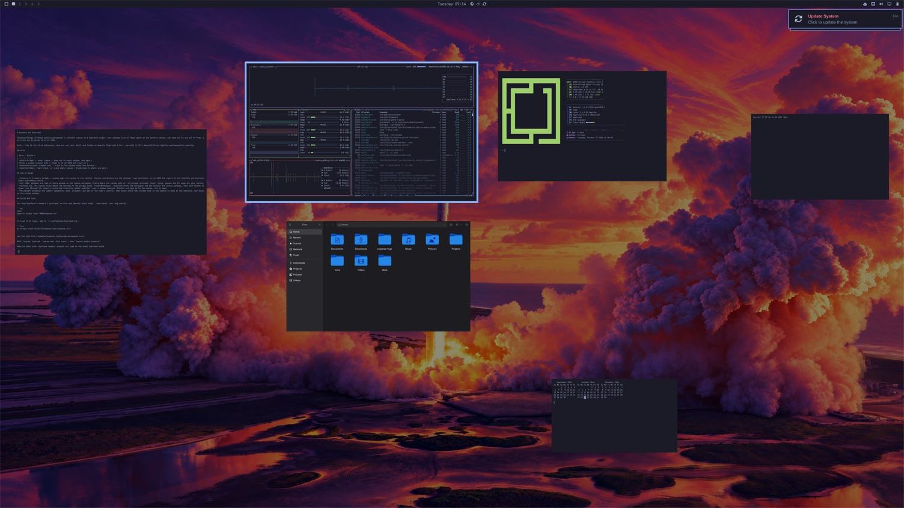

# Expanse for Hyprland

[Expanse](https://github.com/invig/expanse)'s infinite canvas as a Hyprland plugin: your windows live at fixed spots on one endless canvas, you zoom out to see all of them, and click one to glide to it at 100%.

Built and tested on Omarchy (Hyprland 0.56.2, aarch64) in [Try Omarchy](https://github.com/omacom/try-omarchy).



## Using it

| Input | What it does |
| --- | --- |
| <kbd>Alt</kbd> + <kbd>`</kbd>, <kbd>Alt</kbd> + pinch in, or rest the pointer in a bottom corner | Zoom out to every window, and back to where you were |
| Click a window | Glide to it, centred at 100%, and use it |
| <kbd>Super</kbd> + arrows | Glide to the nearest window in that direction; on the canvas, plain arrows |
| Pinch, or <kbd>Super</kbd> + scroll | Zoom the canvas around the pointer |
| Scroll, middle-drag, or <kbd>Space</kbd> + drag | Pan |
| Scroll or pinch on the empty desktop | Start moving around the canvas from 100% |
| Drag a window | Move it; snaps to edges, a 20 px gap and the middle of the screen (hold <kbd>Super</kbd> to turn snapping off) |
| Drag on empty canvas, <kbd>Shift</kbd>-click, <kbd>Super</kbd> + <kbd>A</kbd> | Select windows; drag any selected one to move the group |
| <kbd>T</kbd> | Tidy up |
| <kbd>0</kbd> · <kbd>1</kbd> · <kbd>-</kbd> · <kbd>=</kbd> | Fit everything · 100% · zoom out · zoom in |
| <kbd>Return</kbd> · <kbd>Esc</kbd> | Dive into the highlighted window · clear the selection, then back to 100% |
| Hover <kbd>×</kbd>, or <kbd>Super</kbd> + <kbd>W</kbd> | Close the hovered window, or every selected window at once |
| <kbd>Alt</kbd> + <kbd>Shift</kbd> + <kbd>`</kbd> | Auto-centre on or off. Off: clicking a window that's partly on screen leaves the canvas where it is, for side-by-side work |
| Click or drag on the minimap | Move the view there |
| Click a tile on the workspaces bar | Go to that workspace's canvas, still zoomed out |
| Right-click on the canvas | Back to 100% |

The canvas is remembered in `~/.local/state/expanse/layout.json` (window titles only as a hash): reloading the plugin brings it back exactly, and a window an app opens again, after a restart too, returns to its spot. Unloading the plugin or pausing it puts every window back where it was before the canvas, tiled ones back into their layout; resuming brings the canvas back.

The canvas follows you between screens: it keeps a home layout at the sizes you chose. On a smaller screen windows shrink to fit and the layout tightens, each window keeping its gap to its neighbours; back on the big screen everything returns exactly. Whatever was in the middle of the old screen stays in the middle of the new one, and a window too big for the screen shrinks to fit as you go to it.

Every workspace has a canvas of its own. Zoomed out, the workspaces bar beside the minimap (Expanse's Spaces bar) shows each workspace on the monitor as its desktop picture with a small map of its windows around it, the one you're on outlined; it's hidden while there's only one. Tiles are named as Omarchy's bar names them: with its workspaces 1-10 per monitor, 47 on the fifth monitor is "Workspace 7", the one <kbd>Super</kbd> + <kbd>7</kbd> goes to there. Going to another workspace with the canvas up, from the bar or a workspace bind like <kbd>Super</kbd> + <kbd>2</kbd>, brings the canvas along, zoomed out, so you can pick a window there; the one you left settles where leaving it would have taken you.

New windows open in free space, next to what you were working on, instead of on top of it; if the nearest free spot is off screen, the canvas glides there. A window opened on a workspace that isn't showing gets free space on that workspace's canvas; one that opens mid-glide, or elsewhere while you're zoomed out, is placed once the canvas is back at 100%. Dialogs keep the spot their app gives them. An open menu isn't drawn on the canvas (on the Mac it closes as the canvas takes the keyboard); back at 100% it's still there.

With several monitors, each shows its workspace's canvas, with its own minimap and workspaces bar, and zooms out on its own. A canvas reaches past its monitor's edges, over its neighbours', but a window parked there is neither drawn on the neighbour nor clickable there; keyboard focus still reaches it and centres it on its own monitor. Each workspace remembers the screen it was laid out for, so following you between screens works per monitor, and a workspace that moves to another monitor (when one is unplugged, say) keeps its windows where they were on the screen. Workspaces Hyprland or Omarchy renames as monitors come and go (Omarchy renumbers a monitor's workspaces into its block) keep their canvas, while the plugin is loaded and across a reload. Expanse on the Mac manages one display.

The keys after the first three work on the canvas (zoomed out, or after scrolling on the desktop). <kbd>Super</kbd> stands in for the Mac's <kbd>⌘</kbd> and <kbd>Ctrl</kbd>, so <kbd>Super</kbd> + <kbd>W</kbd> on the canvas closes the hovered window instead of the focused one.

The nearest window that way is the one Expanse on the Mac picks: a window sharing the row (or column) wins, nearest first; failing that, the closest within ~35° of straight that way. A hop pressed mid-glide hops on from the window the glide is heading to.

<kbd>Super</kbd> + arrows take over from Omarchy's focus keys (Hyprland's `movefocus`), which do the same job on a canvas less well: they pick by angle between centres, never centre the window, and can't chain. Hyprland fires every bind on a key, so the example config unbinds those four first. Like `movefocus`, a hop lands with the pointer on the window (unless `cursor:no_warps`), so focus that follows the mouse stays put; a click-centre leaves the pointer where you clicked. <kbd>Ctrl</kbd> + arrows stay with apps for word-jump.

Focus moved from the keyboard (Alt-Tab, other binds) also centres a window that isn't fully on screen; with auto-centre off the canvas stays put and a notification says the window is off-screen. Focus that follows the mouse never moves the canvas.

A full-screen (or maximised) window sits outside the canvas, as a full-screen app does on the Mac: zooming out takes it out of full screen, back to its spot among the others. Leave without picking a window, or pick it, and it goes back to full screen; pick another and it stays where it is on the canvas.

## How it works

- **Camera.** A camera (origin + scale) maps the canvas to the monitor. Canvas coordinates are the windows' real positions, so at 100% the camera changes nothing and Hyprland draws everything itself.
- **At 100%, windows are real.** Every window on the canvas workspace floats where the canvas puts it, off-screen included. Zooming out floats tiled windows where they are. Input, focus, popups and X11 apps all stay native.
- **Zoomed out, windows are drawn through the camera.** No function hooks: Hyprland's only work on x86_64. At the start of each frame the plugin hides the canvas windows from Hyprland's own pass. After Hyprland's windows, it draws each one where the camera puts it, by giving it that box as its current (animated) geometry until the frame is drawn, the way Hyprland draws a window mid-animation, then restores it. The desktop is dimmed underneath; the bar stays on top. Pointer and keys go to the canvas, not to apps.
- **On the canvas, windows are arranged for real.** Dragging, snapping and tidying move the real windows (still drawn through the camera), so there's nothing to reconcile when you leave. The snapping, tidy-up and placement rules are Expanse's, ported line for line.
- **Drawn as Expanse draws them.** Zoomed out, every window has Expanse's soft shadow, in canvas units so it shrinks with the window. Hyprland lays its decorations out for a window's real box, so the windows are drawn without them and each gets its theme border, in its colours, where the camera puts it; during a glide too.
- **Gliding** animates the camera (geometric zoom, straight-line pan of the view's centre), then moves every real window once so the camera is back at 100%, and focuses the picked window. A hop at 100% is the same glide without the zoom: for 0.3 s every window is drawn through the camera.

## Build and load

You need Hyprland's headers (`hyprland` on Arch and Omarchy ships them), `base-devel` and `pkg-config`.

```sh
make
hyprctl plugin load "$PWD/expanse.so"
```

To load it at login, add to `~/.config/hypr/hyprland.lua`:

```lua
hl.plugin.load("/path/to/expanse-hypr/expanse.so")
dofile("/path/to/expanse-hypr/examples/expanse.lua")
```

[examples/expanse.lua](examples/expanse.lua) floats every window from its first frame (a window rule; without it, a tiled window floats where it is when the canvas first touches it) and binds <kbd>Alt</kbd> + <kbd>`</kbd>, <kbd>Alt</kbd> + <kbd>Shift</kbd> + <kbd>`</kbd> and <kbd>Super</kbd> + arrows, with descriptions for Omarchy's key guide. `hl.plugin.expanse.overview()`, `hop("left")`, `tidy()` and `auto_centre()` return their actions, like `hl.dsp.*`, so they work in `hl.bind` and `hyprctl dispatch` alike.

The hot corner is `plugin:expanse:hot_corner`: `bottom` (both bottom corners, the default, since Omarchy's bar has its menu top left), `all`, `top_left`, `top_right`, `bottom_left`, `bottom_right` or `off`. As on the Mac, it fires when you move into a corner: not when a monitor going away leaves the pointer in one. `plugin:expanse:wallpaper = false` puts the canvas on a plain background instead of the dimmed desktop picture:

```lua
hl.config({ plugin = { expanse = { hot_corner = "all", wallpaper = false } } })
```

Those are defaults. As on the Mac, a choice made from the menu below (or `hyprctl expanse corner …` and `wallpaper …`) is saved with the canvas and wins over the config until you pick `default`.

### In Omarchy's menu

Expanse's menu bar icon on the Mac becomes a submenu of Omarchy's menu (<kbd>Super</kbd> + <kbd>Alt</kbd> + <kbd>Space</kbd>): zoom out, tidy up, restore all windows, auto-centre, the desktop picture, pause, the hot corner, and a list of the canvas's keys. Toggles show a ✓ when on. Paste the rows from [examples/omarchy-menu.jsonc](examples/omarchy-menu.jsonc) into `~/.config/omarchy/extensions/omarchy-menu.jsonc`, then:

```sh
omarchy menu refresh
```

Or with `hyprpm` (on Omarchy, `sudo pacman -S hyprpm` first): it builds the plugin against the headers of the Hyprland you're running and loads it.

```sh
hyprpm update
hyprpm add <this repository>
hyprpm enable expanse
hyprpm reload -n
```

Then load it at login with `hyprpm reload -n` instead of `hl.plugin.load` (use one or the other: `hyprpm reload` unloads a plugin it doesn't manage). Keep the `dofile` line: Hyprland reads the config again once the plugin is loaded, and that's when the binds take.

Rebuild after every Hyprland update: plugins are tied to the exact Hyprland build.

## Scripting and tests

`hyprctl expanse` prints the canvas as JSON. `hyprctl expanse` with `toggle`, `open`, `close`, `tidy`, `fit`, `zoom <scale>`, `pan <dx> <dy>`, `hop <left|right|up|down>`, `focus <app>` (or `focus address:0x…`, from `hyprctl clients`), `space <name>` (that workspace's canvas, zoomed out), `select all`, `restore` (every window back into view), `pause [toggle]`, `resume`, `autocentre <on|off|toggle>`, `wallpaper <on|off|toggle|default>`, `corner [<corner>|default]` (no corner prints the hot corner's state) or `keys` (the canvas's keys) drives it, and `pick <x> <y>` clicks the canvas at a global logical point. For debugging, `screen <w> <h>` pretends the screen is that size (no size for the real one), and `pinch <scale>…` sends a two-finger pinch through Hyprland's own input path, as a touchpad would. In Lua, `hl.plugin.expanse.pause()` toggles pausing and `restore()` brings windows back into view.

[scripts/sweep.py](scripts/sweep.py) goes through everything this README says, in a Try Omarchy VM, and checks each from the plugin's state: 108 checks, on a headless monitor of its own ([scripts/sweep-monitors.lua](scripts/sweep-monitors.lua), so the VM's window can be moved or resized meanwhile), with real keyboard and pointer input through QMP, pinches from a virtual touchpad ([scripts/touchpad.py](scripts/touchpad.py), through the kernel's uinput and libinput, as a real one; it needs root in the VM, given with `VM_ASKPASS`) and through Try Omarchy's own pinch device (the one the Mac's trackpad drives), more monitors (headless outputs), a dialog ([scripts/dialog.py](scripts/dialog.py)), and the plugin unloaded mid-glide, zoomed out, mid-drag and as windows open. `make test` checks the nearest-window rule and the layout file case by case. The nearest-window rule, snapping, tidy-up, free-space placement and the layout for a smaller screen were also checked against Expanse's own Swift on thousands of random layouts, with no differences.

[scripts/vm.sh](scripts/vm.sh) syncs, builds and reloads the plugin in a Try Omarchy VM over SSH. [scripts/qmp-input.py](scripts/qmp-input.py) presses keys and moves and clicks the VM's real pointer through QEMU's QMP socket; a virtual keyboard (`wtype`) can't trigger Hyprland keybinds. `hyprctl output create headless` adds a second monitor to test with (the QMP pointer reaches it), and `hyprctl output remove` unplugs it.

## As on the Mac

- **Zoomed out, keys go to the canvas, not to apps**: they move the highlight, zoom and tidy. Click a window (or press <kbd>Return</kbd>) to use it.
- **One canvas per monitor.** Expanse on the Mac manages one display; here each monitor's workspace is a canvas of its own (see above).

## Credits

Techniques learned from [Phantomat](https://github.com/kaolti/phantomat) by kaolti (BSD-3-Clause), itself built on [hyprland-scroll-overview](https://github.com/yayuuu/hyprland-scroll-overview): drawing a window at a box of the plugin's choosing through its animated geometry.

## License

MIT
