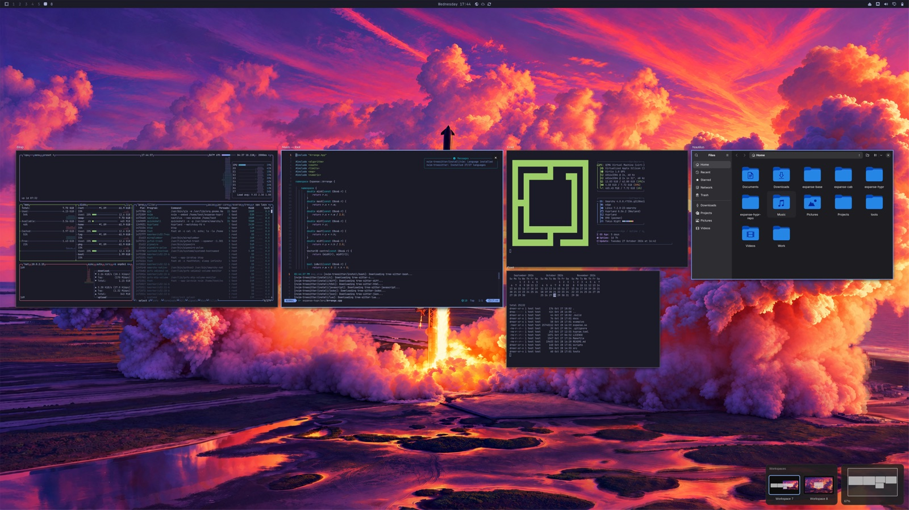

<p align="center">
  
</p>

<p align="center">
  <strong>Every window gets its own place on one endless desktop.</strong><br>
  Zoom out to see them all. Click one to glide straight to it.
</p>

<p align="center">
  <a href="#install"><strong>Install</strong></a> ·
  <a href="#the-basics">How to use it</a> ·
  <a href="#questions">Questions</a> ·
  <a href="https://github.com/invig/expanse">Expanse for Mac</a>
</p>

<p align="center">
  
  
  
</p>

---

Expanse treats your screen as a view onto a much bigger canvas. Your windows stay where you put
them on it; you move the view instead of the windows. Rest the pointer in a bottom corner of the
screen to see everything at once, then click a window to fly to it, ready to use.

It's [Expanse for Mac](https://github.com/invig/expanse) for Omarchy, as a Hyprland plugin, and
it's one more workspace layout next to Omarchy's own: <kbd>Super</kbd> + <kbd>L</kbd> cycles a
workspace through tiling, scrolling, floating and Expanse.

- **See everything at once.** Every window, live, laid out the way you arranged it.
- **Move around by direction.** <kbd>Super</kbd> + arrow keys hop to the next window to the
  left, right, above or below.
- **Arrange like a design tool.** Drag windows around; they snap into neat, even gaps. New
  windows open beside the one they came from.
- **A canvas for every workspace, or just some.** Make Expanse the layout of every workspace, or
  only of the ones you switch to it. Each keeps its own canvas, and each monitor zooms out on its
  own.
- **At home on a laptop or a big display.** On a smaller screen the layout tightens up, columns
  staying lined up, and plugging back in puts it back exactly.
- **Easy to leave.** Switch a workspace to another layout, pause Expanse or remove it, and every
  window goes straight back to where Hyprland had it, tiled ones back into their layout.

## Install

On Omarchy 4:

```bash
omarchy plugin add https://github.com/invig/expanse-omarchy --enable
```

Expanse's icon appears in the bar. Click it and pick **Set up Expanse**. That builds Expanse's
Hyprland plugin from the code you just added, which takes a minute or two, then asks before
adding the one line to `~/.config/hypr/hyprland.lua` that gives Expanse its keys. Last, it asks
whether Expanse should be the layout of every workspace or only of the ones you switch to it
(you can change your mind from the bar icon). From then on it loads at every login, and rebuilds
itself after Hyprland updates.

Nothing else is downloaded, and nothing needs `sudo`: Omarchy already has the compiler and
Hyprland's headers.

## The basics

| Do this | To |
|---|---|
| <kbd>Super</kbd> + <kbd>L</kbd> | Switch the workspace's layout: tiling, scrolling, floating, Expanse (<kbd>Super</kbd> + <kbd>Alt</kbd> + <kbd>L</kbd> goes back) |
| Rest the pointer in a bottom corner, or press <kbd>Alt</kbd> + <kbd>`</kbd> | Zoom out to every window (do it again to go back) |
| Click a window | Glide to it and start using it |
| <kbd>Super</kbd> + <kbd>←</kbd> <kbd>→</kbd> <kbd>↑</kbd> <kbd>↓</kbd> | Hop to the next window in that direction |
| Pinch, or scroll with two fingers | Zoom and move around the canvas |
| Drag a window while zoomed out | Move it; it snaps into place |
| <kbd>T</kbd> | Tidy up: each group of windows lined up and evenly spaced, where it is |
| <kbd>Esc</kbd> | Back to 100% |

<details>
<summary><strong>All shortcuts</strong></summary>

| Do this | To |
|---|---|
| <kbd>Ctrl</kbd> + <kbd>Alt</kbd> + <kbd>C</kbd> | Centre the window you're in |
| <kbd>Super</kbd> + scroll | Zoom around the pointer |
| <kbd>Space</kbd> + drag, or middle-drag | Move around the canvas |
| <kbd>Alt</kbd> + pinch in | Zoom out to every window, from anywhere |
| Click empty desktop | Zoom out to every window |
| Scroll or pinch on empty desktop | Start moving around the canvas from 100% (when the scroll stops, the view settles where fewer windows are cut off by the screen's edges) |
| Drag on empty canvas, <kbd>Shift</kbd>-click, or <kbd>Super</kbd> + <kbd>A</kbd> | Select windows, then drag any of them to move the group |
| Hold <kbd>Super</kbd> while dragging | Move without snapping |
| <kbd>0</kbd> · <kbd>1</kbd> · <kbd>-</kbd> · <kbd>=</kbd> | Fit everything · 100% · zoom out · zoom in |
| Arrow keys · <kbd>Return</kbd> | Move the highlight · dive into the highlighted window |
| Hover <kbd>×</kbd>, or <kbd>Super</kbd> + <kbd>W</kbd> | Close the window, or every selected window |
| Click the minimap | Move the view there |
| Right-click | Back to 100% |
| <kbd>Alt</kbd> + <kbd>Shift</kbd> + <kbd>`</kbd> | Turn auto-centring on or off (off suits side-by-side work) |

</details>

**Workspaces** in Expanse each have a canvas of their own. The workspaces bar next to the
minimap, at the bottom of the screen, shows them; click one to go there, or use Omarchy's
workspace keys as usual. Switch a workspace to another layout and windows that arrived tiled tile
again, the rest staying where they are on screen; switch it back and every window goes back to its
spot on the canvas.
On a workspace in another layout, <kbd>Super</kbd> + arrows move the focus as Omarchy's keys do.

**Full-screen windows** step out of full screen while you're zoomed out, back to their place among
the others, and go back to full screen when you return to them.

**Window names** above the windows are off, as on the Mac; turn them on from the bar icon.

**Dialogs and password prompts** never wait unseen behind the canvas: one that opens while you're
zoomed out brings you back to it. A window pinned above the rest (picture in picture) stays above
the canvas too.

**The bar icon** has the rest: Tidy Up, Centre Current Window, Restore Layout, Restore All
Windows, auto-centring, the desktop picture, window names, Pause, which corners to use, Expanse
here or on every workspace, Troubleshooting, and the shortcuts. Right-click it to zoom out.

## Questions

<details>
<summary><strong>The corner or <kbd>Super</kbd> + arrows do nothing</strong></summary>

The workspace may be in another layout: press <kbd>Super</kbd> + <kbd>L</kbd> until it says
Expanse, or pick **Use Expanse Here** from the bar icon.

If the icon offers **Set up Expanse**, Expanse isn't running yet: pick it. If setup ran but you
said no to adding its line to `hyprland.lua`, add this to the end of that file:

```lua
dofile(os.getenv("HOME") .. "/.config/omarchy/plugins/io.github.invig.expanse/examples/expanse.lua")
```

The corners that zoom out are the bottom two (Omarchy's menu lives top left). Pick others from
the bar icon › **Hot Corner**.

</details>

<details>
<summary><strong>My windows ended up somewhere odd</strong></summary>

The bar icon › **Restore Layout** puts them back the way they were earlier. Expanse keeps your
last three layouts, saved at least 15 minutes apart, and a restore can be undone too. **Tidy Up**
neatens things where they are. As a last resort, **Restore All Windows** brings every window
into view.

</details>

<details>
<summary><strong>Something's not right: how do I report it?</strong></summary>

From the bar icon › **Troubleshooting**: turn on **Detailed Logging**, do whatever went wrong
again, then pick **Copy Logs for a Bug Report** and paste it into a new issue (**Report an Issue**
opens one). The report has your Expanse, Hyprland and Omarchy versions, your monitors and
settings, and Expanse's log, which names windows by app, never by their titles.

</details>

<details>
<summary><strong>It stopped working after an update</strong></summary>

Hyprland plugins are built for one exact Hyprland, so Expanse rebuilds itself at the next login
after Hyprland changes. If that build fails, a notification says so, and **Set up Expanse** in
the bar icon's menu runs it again where you can see why. Please
[open an issue](https://github.com/invig/expanse-omarchy/issues) with what it shows.

</details>

<details>
<summary><strong>What does it keep, and what does it send?</strong></summary>

Nothing is sent anywhere: Expanse makes no network requests. Its build lives in
`~/.local/share/expanse-omarchy/`, and the only other files it writes are its layouts in
`~/.local/state/expanse/`: window positions and sizes, app names, and a scrambled fingerprint
(a hash) of each window's title, which recognises the window without storing the title. With
Detailed Logging on, its log goes there too (`expanse.log`, at most 5 MB, the older half kept as
`expanse.1.log`); it names windows by app, never by title.

</details>

<details>
<summary><strong>What can't it do?</strong></summary>

- **No typing while zoomed out**, as on the Mac: zoomed out, keys move around the canvas. Click a
  window, or press <kbd>Return</kbd>, to use it.
- **No smart zoom.** The Mac's two-finger double-tap has no equivalent on Linux touchpads.
- **Hyprland 0.56 or later only**, with a Lua config, as Omarchy 4 has. It has been tested on
  Omarchy on ARM, in a virtual machine;
  [open an issue](https://github.com/invig/expanse-omarchy/issues) if anything misbehaves.

</details>

<details>
<summary><strong>How is it different from Expanse for Mac?</strong></summary>

- <kbd>Super</kbd> stands in for <kbd>⌘</kbd> and <kbd>⌃</kbd>, and <kbd>Alt</kbd> for <kbd>⌥</kbd>.
- Expanse is a layout you choose per workspace, next to tiling, scrolling and floating; on the
  Mac it's every window. Every workspace in it has its own canvas, and every monitor its own view;
  the Mac uses one display.
- Settings live in the bar icon's menu, and in Hyprland's config for the defaults.

</details>

<details>
<summary><strong>How do I uninstall it?</strong></summary>

Click Expanse's icon in the bar and pick **Remove Expanse**. Your workspaces go back to the layout
they had before, your windows go back where Hyprland had them, and it asks before taking its line
out of `hyprland.lua` and deleting its saved layouts. Or by hand:

```bash
omarchy plugin remove io.github.invig.expanse
rm -rf ~/.local/share/expanse-omarchy ~/.local/state/expanse
```

then delete the Expanse line at the end of `~/.config/hypr/hyprland.lua`, switch any workspace
still in Expanse to another layout from Omarchy's menu (Appearance › Workspace Layout), and log
out and back in.

</details>

## For tinkerers

<details>
<summary><strong>Scripting with <code>hyprctl expanse</code></strong></summary>

```bash
hyprctl expanse                   # the canvas, as JSON
hyprctl expanse toggle            # zoom out / back
hyprctl expanse tidy
hyprctl expanse hop left          # left | right | up | down
hyprctl expanse centre            # the window you're in, to the middle
hyprctl expanse focus firefox     # an app's window (or address:0x… from hyprctl clients)
hyprctl expanse space 2           # a workspace's canvas, zoomed out
hyprctl expanse layout            # the saved layouts; layout 0 restores the newest (1, 2: older)
hyprctl expanse pause             # windows back to Hyprland's layout
hyprctl expanse resume
```

Also `open`, `close`, `fit`, `zoom <scale>`, `pan <dx> <dy>`, `select all`, `restore`,
`autocentre <on|off|toggle>`, `wallpaper <on|off|toggle|default>`, `names <on|off|toggle|default>`,
`corner [<corner>|default]`, `keys`, `log` (this run's log) and `logging [on|off|toggle]` (Detailed
Logging). In Lua, `hl.plugin.expanse.overview()`, `hop("left")`, `tidy()`, `centre()`,
`restore_layout(0)`, `auto_centre()`, `pause()` and `restore()` return actions for `hl.bind`.

</details>

<details>
<summary><strong>Settings in Hyprland's config</strong></summary>

Expanse is a Hyprland layout called `expanse`. Without Omarchy's layout switching, make it every
workspace's, or some workspaces':

```lua
hl.config({ general = { layout = "expanse" } })
hl.workspace_rule({ workspace = "3", layout = "expanse" })
```

Its own settings:

```lua
hl.config({ plugin = { expanse = { hot_corner = "all", wallpaper = false } } })
```

`hot_corner` is `bottom` (the default), `all`, `top_left`, `top_right`, `bottom_left`,
`bottom_right` or `off`; `wallpaper = false` puts the canvas on a plain background;
`window_names = true` shows app names above the windows. These are defaults: a choice made from
the bar icon wins until you pick the default again (`hyprctl expanse corner default`,
`wallpaper default`, `names default`). The keys are in
[examples/expanse.lua](examples/expanse.lua); copy it and load your copy instead to change them.

</details>

<details>
<summary><strong>Without Omarchy's plugin system</strong></summary>

With `hyprpm`, which builds against the Hyprland you're running:

```bash
hyprpm update
hyprpm add https://github.com/invig/expanse-omarchy
hyprpm enable expanse
hyprpm reload -n
```

Or by hand. You'll need a compiler, `make`, `pkg-config` and Hyprland's headers:

```bash
git clone https://github.com/invig/expanse-omarchy
cd expanse-omarchy
make
hyprctl plugin load "$PWD/expanse.so"
```

Either way, load the keys from `hyprland.lua`, with `hl.plugin.load("/path/to/expanse.so")`
before it if you built by hand (with `hyprpm`, `hyprpm reload -n` at startup loads it), and make
`expanse` the layout of the workspaces you want as canvases (see the settings above):

```lua
dofile("/path/to/expanse-omarchy/examples/expanse.lua")
hl.config({ general = { layout = "expanse" } })
```

Rebuild after every Hyprland update. To use Omarchy's menu instead of the bar icon, paste the rows
from [examples/omarchy-menu.jsonc](examples/omarchy-menu.jsonc) into
`~/.config/omarchy/extensions/omarchy-menu.jsonc` and run `omarchy menu refresh`.

</details>

Curious how it draws a zoomed-out Hyprland, and how it's tested? See
[How Expanse works](docs/how-it-works.md).

## Thanks

- [Expanse for Mac](https://github.com/invig/expanse), whose layout rules this follows line for
  line.
- [Phantomat](https://github.com/kaolti/phantomat) by kaolti (BSD-3-Clause), built on
  [hyprland-scroll-overview](https://github.com/yayuuu/hyprland-scroll-overview), for drawing a
  window at a box of the plugin's choosing through its animated geometry.
- [Omarchy](https://omarchy.org), and [Try Omarchy](https://github.com/omacom/try-omarchy), where
  Expanse was built and tested.

## Licence

[MIT](LICENSE)
